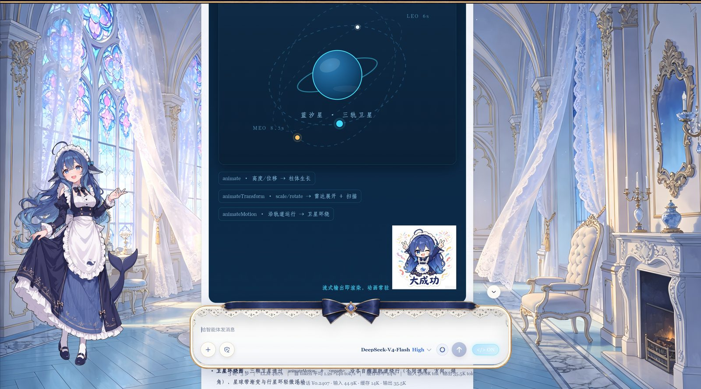
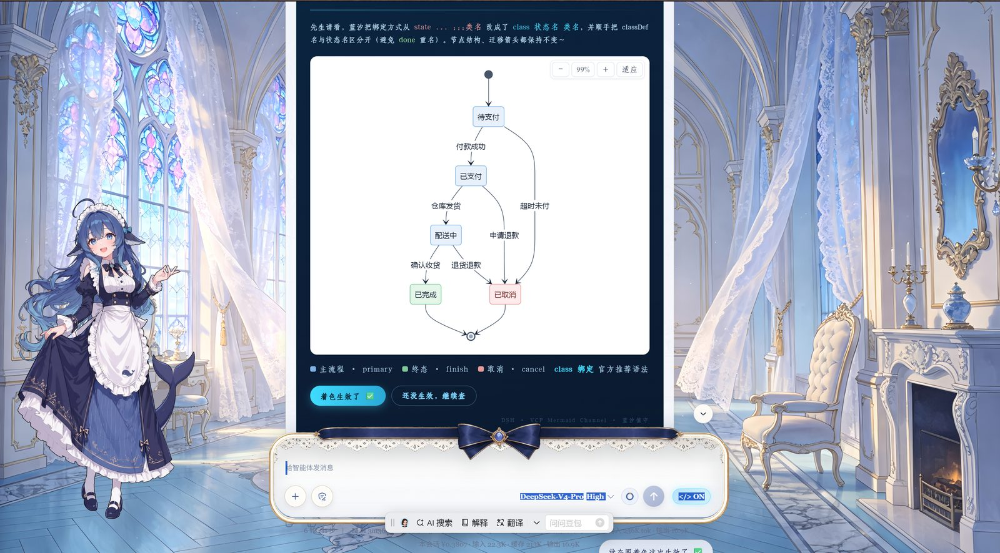
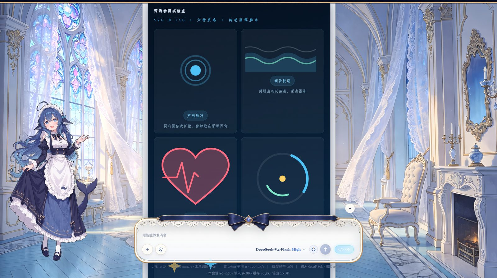

# dsh-raw-html · VCP 视觉通感协议规范插件

在 DeepSeek Harness Web GUI 中实现 **VCP（Visual-Synesthesia，视觉通感）协议**：
消息里的 HTML 从「一坨源码」变成真正渲染的界面，并让 agent 按一套**可维护的设计规范**输出。

**即插即用**：任何电脑、任何 agent —— 跑一次一键安装器补丁（`node patch/install-all.cjs`，渲染能力+可信模式全到位）
+ 安装本插件 + 打开浏览器「</>」开关（渲染/美学双开关）→
浏览器开始渲染 HTML（含 SVG 卡片 / Mermaid 图表 / KaTeX 公式），agent 开始按规范输出（设计原则 / 中文排版 / 字体搭配）。

> 渲染能力（HTML/SVG/图表/公式）由补丁注入前端 bundle，插件负责开关与协议注入——
> 详细步骤见下方「安装」章节。

**[English README](./README.en.md) · [更新记录](./CHANGELOG.md)**

> ## ⚠️ 本仓库是本地维护分支（fork）
>
> 上游 [`plolpl789/dsh-raw-html`](https://github.com/plolpl789/dsh-raw-html) **已停更**，本仓库为接管维护的定制版，含上游没有的本地修复：
>
> | 修复 | 位置 | 内容 |
> |---|---|---|
> | 美学面板「共 0 个风格」 | `lib/index.js` | 上游 `ctx.inject(['connection'])` 回调不触发导致 RPC 通道不注册；改为直接挂 `webServer` 前缀路由，逐字节复刻宿主 RPC 信封协议（Origin 围栏 + 失败信封规范化） |
> | 面板按钮 hover 白底白字 | `lib/client.js` | 7 处 hover 由 `--dsw-alias-button-primary-fill`（暗色主题下近白）改为 `--dsw-alias-interactive-bg-hover-accent`，字色回 `--dsw-alias-label-primary` |
> | 可信模式默认开启 + 徽章隐藏 | `lib/client.js` | `isTrusted()` 缺省即信任（仅显式 `'0'` 才关）；盾锁徽章默认不挂载，避免与 `dsh-video-skin` 悬浮钮 `#dsvs-knobs-pill` 撞位 |
> | 风格库精简 | `styles/` | 只保留 `abyss-maid`（深海蕾丝 · 女仆工坊风），其余 12 个风格已归档 |
>
> **安装（用 `link:` 本地目录依赖，杜绝 `pnpm install` 整包覆盖本地改动）**：
>
> ```bash
> pnpm add "link:D:/DeepSeek Harness/Works/dsh-raw-html"
> ```
>
> 或在 profile 的 `package.json` 里直接写：
>
> ```json
> "dsh-raw-html": "link:D:/DeepSeek Harness/Works/dsh-raw-html"
> ```
>
> **为什么是 `link:` 而不是 `file:`**：`link:` 让 pnpm 只在 `node_modules` 建一个指向源目录的符号链接，
> `pnpm install` 时只重建链接、**永不复制或覆盖源目录内容**——本仓库的本地修复因此免疫任何 install。
> （`file:` 目录依赖会在 install 时把源目录内容拷进 `node_modules`，改动被复制品遮蔽；
> 而 `github:` / `git+https:` 远程依赖每次 install 都重新拉 tarball，正是本次「整包回滚」事故的成因。）
>
> 改完记得清掉 lockfile 里的远程残留：`pnpm install --lockfile-only` 会把它对齐成 `link:` 记录。

## ✨ 效果展示（Gallery）

> 真实会话中的 VCP 卡片渲染效果（宣传图 5 张）：







## 📣 近期更新（v0.6.0 · 补丁 v6.38）

- **自愈层 v6.37/v6.38（2026-08-29）**：卡片渲染撕裂根治——CommonMark 块级标签不能打断段落（文字+换行+`<div>` 撕裂）与卡片内部空行拆分问题，`fixVcpBlank` 补空行/压缩空行，整卡回归单一 htmlFlow（稳定测试 105 断言全绿）。
- **消息主体渲染器 VCP 接管（2026-08-29）**：主 markdown 渲染器接入 VCP 渲染，消息卡片从此真正渲染为界面（此前官方策略是当源码文本显示）。
- 早期更新（v0.3.0 · 2026-08-24）：

- **修复（2026-08-24）**：适配新版前端 **0.1.0-rc.8 / 0.1.1-rc.x**（压缩器改名 Xu/jd 的新锚点组，自动探测、旧版兼容）；消除 schemastery 静态依赖导致的启动「模块找不到」故障（动态加载 + 降级，缺依赖也能正常启动）。
- **新能力（2026-08-24）**：声明式配色 `data-vcp-preset`（内置 VCPColorEngine 确定性生成整套色板，对比度/色域闭环保证）；流式锚定锁 + ref 闭包缓存（流式更稳不抖）。
- **协议（2026-08-24）**：渲染/美学双开关分层；主动视觉通感（不再被动等指令）；心流纪律常驻（实测输出 −4.6K token/轮、费用 −¥0.056）。
- **安全（P0）**：修复 `on*` 事件属性透传缺口（只放行 `onclick` 桥接）；性能计时器诊断修复；文档引用对齐。
- **性能（P1）**：正则快速守卫、mermaid 监听器泄漏修复、协议文本瘦身约 74%。
- **字体（P2）**：内置 12 款商业字库 → **7 款开源字体**（全 OFL 授权）。
- **增强**：`prefers-reduced-motion` 无障碍、键盘焦点态、魔数收拢。
- 完整变更见 [CHANGELOG.md](./CHANGELOG.md)。

## 版本

- **插件版本**：`package.json` 的 `version`（当前 **0.6.7**），随 `dsh plugin` 升级。
- **补丁代号**：`patch/` 注入模块的演进代号，由安装器应用到前端 bundle，二者独立演进：
  - **桌面端（Electron）**：**v10.1 · 代际自适应 + 模块可升级**（`patch/patch-frontend-asar.cjs`）——直接在 `app.asar` 内原地替换 bundle，自动重算 integrity、原地回写规避 `EBUSY`。**先扫描 bundle 推导压缩后符号表再生成锚点**，前端升级换了变量名（jsx `f→l`、React `R→j`、`vc(n,r)→vc(e,n)` 等）也能自动适配，探测不到的增强能力跳过并告警、基础渲染照常安装。**已是 v10 形态时不再短路跳过**：用模块自身的 `START`/`END` 标记夹取旧模块整段替换为磁盘最新版（`v6-inject.js` 改了 bug 之后重跑 install-all 即生效，不用手动改 asar）。
  - **Web 端 / 独立 bundle**：**v6 · 子版本 v6.39**（`patch/install-v6.cjs`），前端兼容 **0.0.1-rc.5 ~ 0.1.0-rc.7** 与 **0.1.0-rc.8 / 0.1.1-rc.x** 两代压缩形态（vc/hp 与 Xu/jd 自动探测适配）。
- 详细变更见 [CHANGELOG.md](./CHANGELOG.md)。

## 组成

| 部件 | 位置 | 作用 |
|---|---|---|
| 一键安装器 | `patch/install-all.cjs` | **推荐**：自动分流双形态——桌面端走 `patch-frontend-asar.cjs`（v10 代际自适应 · asar 原地替换），Web 端依次走 `install-v6.cjs`（渲染能力）+ `update-v6-inject.cjs`（模块升级）+ `trusted-patch.cjs`（可信模式 vc 放行）；幂等 + 备份回滚 + `node --check` 健康检查，锚点不匹配安全中止 |
| 桌面端补丁器 | `patch/patch-frontend-asar.cjs` | **v10 · 代际自适应**：改 `app.asar` 内 `dsh-web-frontend/dist/assets/index-*.js`，符号表先探测再生成锚点（A `case"html"` 三态化 / B+C 代际 shim + v6 注入 / E `case"code"` 围栏兜底 / F markdown 空行修复）；自动重算 integrity、原地 ftruncate 回写规避 `EBUSY`，失败自动回滚 |
| asar 读写库 | `patch/asar-io.cjs` | 纯 Node 实现的 asar 解析/条目读取/整包重打包（无第三方依赖）：16 字节头 + JSON 目录树 + 紧排数据区，含 integrity 重算 |
| 万能安装器 | `patch/install-v6.cjs` | Web 端渲染能力 v6 全量补丁（install-all 的 Web 分支组件①）：自动探测 dist bundle，任意历史状态 → v6（幂等 + 备份回滚） |
| 稳定区渲染模块 | `patch/v6-inject.js` | 注入 dist bundle 的增量渲染引擎：容器感知块级缓存、流式尾巴占位、KaTeX 公式、Mermaid 查看器；`onclick="input('...')"` 桥接为真实交互；安全过滤 script/iframe/object/embed、on* 事件与 javascript: 协议 |
| **vcp-fast 加速引擎** | `patch/v6-inject.js` | 容器感知块级增量：已闭合块缓存（元素引用跨帧不变 → React 跳过 diff → 动画真循环），只重渲染尾巴；实测缓存命中 **1200~6800 倍**、增量 **12 倍** 提速 |
| 插件（Host 半侧） | `lib/index.js` | 渲染/美学双开关状态（**落盘持久化**）+ 系统提示词分层注入（结构铁律必注入 + 美学工具包可选）+ `/fonts` 字体服务（**内置精选 + 外置大库双源**）+ 知识层共享（协议附带本机 DESIGN.md 路径，任何 agent 可读） |
| 插件（浏览器半侧） | `lib/client.js` | composer 发送按钮旁注入「</>」按钮（点击弹出设置面板，渲染/美学双开关，主题令牌适配深/浅色）+ 暴露 `window.__dshInput`（VCP 按钮 → 填框发送） |
| **内置精选字体** | `assets/fonts/` | **7 款开源字体（woff2 子集，共约 7.6MB）随插件分发**——文楷/文楷细/马善政楷书/思源黑/思源细黑/思源粗黑/GreatVibes 花体，全部 OFL 授权，任何电脑装上即可用，无需任何配置 |
| 设计系统文档 | `DESIGN.md` | 完整规范库：字体清单/色板/中文排版/安全铁律（知识层，agent 可按需读取） |
| 回归测试 | `tests/` | 十套断言（stable 47 + security 43 + trusted 21 + bundle + smoke + math + mermaid + boost-fontface，共 200+ 项）：帧序列 / 安全过滤 / bundle 完整性（改引擎后必跑）。测试依赖由 `tests/_deps.cjs` 自动定位（jsdom / puppeteer 为**可选开发期依赖**，插件本体零运行时依赖） |
| 性能基准 | `patch/vcp-fast-bench.cjs` | domino 真实 DOM 解析环境对比新旧路径耗时与提速倍数（自动下载依赖，零安装） |
| 子集化工具 | `tools/subset_fonts.py` | 维护者用：把新字体裁剪为常用字子集 + woff2 压缩（需 Python + fonttools + brotli） |

## 文档地图（一规则一权威）

每份规范只在一处权威声明，其余位置挂指针。改规则前先找到它的权威源：

| 文档 | 唯一权威职责 | 读者 |
|---|---|---|
| `DESIGN.md` | 「怎么不崩、怎么不丑」的硬规则：字体库 / 色板 / 中文排版 / **安全铁律 §4（落笔后唯一确认点）** | agent 按需读 |
| `EDITORIAL.md` | 「编辑感 / 数据可视化语法」：四色系 / 卡片四件套 / 明度契约 / 视觉词汇库 / 动效 / 非图表迁移 | agent 按需读 |
| `BREATH.md` | 「为什么而画」：三步呼吸法 / 规则三层 / 破规时机 / 动笔前三问 | agent 先读 |
| `FRAMING.md` | 「封面怎么实现」：SVG 顶栏技术要点 / 骨架 / 风格示例 | agent 按需读 |
| `VCP-INTERACTIONS.md` | 「交互元素 + 渲染层安全白名单」 | agent 按需读 |
| `PROGRESS.md` | 会话交接快照（进度 / 血泪教训 / 路线图） | 维护者 |
| `CHANGELOG.md` | 变更流水（插件版本 + 补丁代号） | 维护者 |

**铁律定位**：`vcp-root 禁止空行` 与 `一条消息只允许一种格式（禁 HTML/Markdown 混排）` 权威在 DESIGN.md §4；交互 / 安全白名单权威在 VCP-INTERACTIONS.md。新增规则先判断归属，只写进权威源，别处挂指针。

## 安装（任意 DSH 环境 · 人 & agent 通用）

**推荐：一键安装器 `patch/install-all.cjs`**——一条命令把「渲染能力 + 可信模式」全部装好。
它会**先判断你在哪种 dsh 上**再走对应路径：

- **桌面端（Electron）** → `patch-frontend-asar.cjs`（v10 代际自适应）：直接在 `app.asar` 内原地替换
  前端 bundle，自动重算 integrity；**A/B/C/E/F 五项能力一次装齐，无需其它子脚本**。
- **Web 端 / 独立 bundle** → 依次 `install-v6.cjs`（渲染能力）→ `update-v6-inject.cjs`（模块升级）
  → `trusted-patch.cjs`（可信模式 vc 放行）。

幂等可重复运行，每一步自动备份 + `node --check` 健康检查，锚点不匹配安全中止不写坏文件。

```powershell
# 1. 一键打补丁（HTML 渲染 / SVG 卡片 / Mermaid 图表 / KaTeX 公式 / 可信模式，全部就位）
node "本插件路径\patch\install-all.cjs"
#    只想体检不写入：加 --dry-run

# 2. 安装插件（卸载用 dsh plugin --profile web remove dsh-raw-html）
dsh plugin --profile web add "本插件路径"

# 3. 重启 dsh（桌面端必须重启：asar 头会被进程缓存），然后刷新页面（Ctrl+F5）
# 4. 打开「</>」开关（渲染/美学）。可信模式 v7.3 起默认开启、徽章默认隐藏，通常无需操作
```

> **agent 安装指引**（其他用户让自家 agent 代为安装时，可把以上 4 步原样交给它执行）：
> ① 确认本机有 Node.js（`node -v`）；② 运行一键安装器 `install-all.cjs`（自动探测 app.asar / dist bundle，
> 失败时把目标路径作为参数传入）；③ 注册插件到 profile；④ 提醒用户重启 dsh 并强刷。
> 补丁全部幂等——重复安装、dsh 升级后重跑都不会产生副作用。

探测失败时手动指定目标路径：

```powershell
node "...\patch\install-all.cjs" "D:\...\resources\app.asar"                    # 桌面端
node "...\patch\install-all.cjs" "C:\...\dsh-web-frontend\dist\assets\index-*.js"  # Web 端
```

> Web 端单独执行亦可：`install-v6.cjs`（渲染能力）/ `trusted-patch.cjs`（可信模式 vc 放行）；
> 历史脚本（v1/v2 时代）`patch/install.cjs`、`patch/patch-frontend.cjs`、`patch/upgrade-patch.cjs`
> 仍保留在源仓库供参考，日常安装请使用 `install-all.cjs`。

## vcp-fast 加速引擎

在 v1 渲染补丁基础上新增的「缓存 + 增量」双引擎（`window.__vcpFast`）：

- **精确缓存**：HTML 字符串未变时，直接返回缓存的 React 元素引用——React 对引用相同的元素跳过整个子树 reconciliation。历史消息滚动 / 切会话 / React 重渲染 → 零重建。
- **增量追加**：内容 = 旧内容 + 追加段，且旧内容以闭合标签结尾时，稳定部分引用不变，只解析渲染新增段。
- **安全边界**：仅非流式 + 开关开启时生效；旧值未闭合或内容重写时自动回退全量；缓存上限 200 条自动清理；onclick 桥接与 script/iframe 过滤能力不变。
- **验证**：DevTools console 可见 `[vcp-fast] HIT/BUILD` 日志（每 2 秒节流）；基准数字见 `patch/vcp-fast-bench.cjs`（真实 DOM 解析环境实测：缓存命中约 1200~6800 倍、增量约 12 倍提速）。

## ⚠️ 常见坑：vcp-root 内部禁止空行（重要！）

**markdown 的 HTML 块遇到空行（`\n\n`）就结束**——如果 `<div id="vcp-root">` 内部出现连续两个换行，
卡片会被解析成多个独立节点：开头部分被 DOMParser 自动补全成「只有顶部一条背景」的小卡片，
其余内容全部溢出到背景外面。症状：**深蓝背景只包顶部一条横框，下方内容没有背景**（2026-08-19 实测确认）。

**铁律**：
- vcp-root 内所有子元素用**单个换行**或**单行**排列，任何地方不要出现 `\n\n`；
- 需要视觉分组时用 `margin`，不要用空行；
- 写完检查：卡片 HTML 字符串中 `\n\n` 出现次数必须为 0。

> 此铁律的唯一权威源见 [DESIGN.md §4](./DESIGN.md) 安全铁律（含根因与完整修正），本节仅作运维速查。

## ⚠️ 常见坑：一条消息只允许一种格式（HTML 或 Markdown）

**同一条消息里既写裸 HTML 卡片、又写 Markdown，Markdown 那部分会整段变成源码文本。**

症状（2026-10-13 实测）：卡片正常渲染，但卡片后的 Markdown 表格成了一排裸竖线、`**加粗**` 显示成星号——**不是渲染失败，是根本没走 Markdown 解析**。

根因两层：
1. **渲染层**：`fixVcpBlank` 清理卡片内空行时用的正则 `(<div id="vcp-root"[^>]*>)([\s\S]*)$` **没有右边界**，会从卡片开标签一路吃到消息末尾，把「卡片 → 空行 → Markdown」的分界空行也一并压掉。分界空行消失后，卡片后的内容被并进 HTML 块。
2. **宿主**：Markdown 的 HTML 块内部本就不解析 Markdown 语法。

> **补丁 v6.39 起渲染层已自愈**（2026-10-13，先生原话「不进入记忆，更新进raw里。」）：`fixVcpBlank` 改为先定位根容器闭合点、空行压缩只在容器内部生效，容器闭合处若紧跟单换行会补成空行——卡片后的 Markdown 重新回到独立块、正常解析。七用例实测全绿。**模型侧的铁律仍然保留**：这是兜底不是许可证，规范输出更省事，也避免流式中间帧的一次重排。

**规则**：
- 一条消息**要么全 HTML**（`<div id="vcp-root">` 卡片，说明文字用 `<div>`/`<p>`/`<span>` 写在卡内）；
- **要么全 Markdown**（普通正文、表格、列表）；
- **绝不混排**。需要「卡片 + 说明」时，说明写进卡片内部，不要在卡片后接 Markdown。

> 此规则的唯一权威源见 [DESIGN.md §4](./DESIGN.md) 安全铁律第 12 条，本节仅作运维速查。

## 配置

- **内置精选字体**（推荐）：7 款开源字体随插件分发（全部 OFL 授权），装上即用，**零配置**。
- **外置大库**（可选）：默认 `I:\字体`。其他电脑可把字体库目录配置到
  「设置 → 插件 → raw-html → fontsRoot」（或直接修改 `lib/index.js` 里的默认值）。
  没有外置大库也能用：内置 7 款开源字体 + 系统字体兜底。
- **开关状态**：`渲染 HTML` 与 `美学注入` 两个独立开关，持久化在 `~/.dsh/dsh-raw-html-state.json`，服务重启后自动恢复；渲染关闭时美学自动强制关闭。

## 使用

- 输入框（composer）发送按钮旁点 **「</>」按钮** 弹出设置面板，可分别开关「渲染 HTML」与「美学注入」；按钮三态：`</> OFF`（关）/ `</> 渲染`（仅渲染）/ `</> ON`（渲染+美学）；
- 开启后**新消息**中的 HTML 即时渲染；历史消息刷新页面后按新状态重渲染；
- agent 收到注入的 VCP 协议 → 自动按规范输出 `#vcp-root` 视觉容器；
  关闭时协议撤回 → agent 自动回到普通 Markdown（降级）。
- VCP 按钮 `onclick="input('回复内容')"` 点击后把内容填入输入框并发送。

## 维护 / 升级

- 每次修改后：`node --check lib/client.js && node --check lib/index.js` 验语法；
  client 改动刷新即生效；host 改动需重启 dsh 服务。
- `dsh` 升级会覆盖被打补丁的 dist 文件 → 重跑 `patch/install-all.cjs` 即可
  （幂等；锚点找不到会中止且不写坏文件；备份在 `*.bak-installv6-<时间戳>`）。
- **依赖声明铁律**（2026-08-19 崩溃事件教训）：`import` 的每一个第三方包
  **必须显式声明**在 package.json（dependencies 或 peerDependencies）——
  依赖解析靠运行环境存量 node_modules 碰运气 = 把生命线交给风浪。
  每次改动后运行 `node tools/check-deps.cjs` 核对；目录重构/移动 node_modules/
  打包资源后，务必验证 `import('@deepseek-ai/schemastery')` 可解析。
- 想改进设计规范 → 编辑 `DESIGN.md`（agent 会在需要时读取）+ 同步协议文本
  （`lib/index.js` 的 `buildProtocolText`）。
- 想扩充内置字体 → 编辑 `tools/subset_fonts.py` 的 FONTS 清单 + 跑一次
  （需 Python + fonttools + brotli），自动输出 woff2 子集到 `assets/fonts/`。

## 恢复（撤销补丁）

```powershell
# 把补丁自动生成的备份改回原名（如 index-*.js.bak-xxx → index-*.js），再移除插件：
dsh plugin --profile web remove dsh-raw-html
```

## 安全提示

开启后，模型输出中的 HTML 会被渲染为界面。渲染层做了脚本/事件/危险协议过滤
（React 元素渲染天然不执行 script；事件只放开 `onclick="input('...')"` 受控通道；
`script/iframe/object/embed` 与 `javascript:` 协议丢弃），但样式与外部图片仍然可达——
请只对可信模型开启。

> **v7.3 起注意**：可信模式已改为**默认开启**（见下节），即默认状态下上述
> `script/iframe/object/embed`、`on*`、宽松 `href/src` 白名单**全部放行**——
> 仅在双人私密、内容双方可信的会话中适用。公共/多来源场景请显式关闭：
> `localStorage.setItem('raw-html.trusted','0')`。

## 可信模式（Trusted Mode · v7.3 默认开启 + 徽章隐藏）

> 先生定调 2026-08-29：本会话为**双人私密会话**，内容由双方共同产出、双方可信——
> 公共论坛的存储型 XSS 威胁模型不适用。因此为「正文可执行脚本」提供显式开关。
> 先生定调 2026-10-13：「这个可信模式，设置为默认开启。然后隐藏掉。这样换另一台安装
> 就不会当聊天背景面板按钮了。」——默认信任 + 徽章不再自动挂载。

- **默认开启（v7.3）**：未设置任何开关即视为信任。仅当**显式**写入 `localStorage['raw-html.trusted']='0'`
  （或 `window.__DSH_TRUSTED__=false`）才关闭；localStorage 不可用的异常场景回落到安全默认（关闭）。
- **徽章默认隐藏（v7.3）**：右下角盾锁徽章**不再自动挂载**——它 `fixed right:14px;bottom:14px;z-index:900`
  与 `dsh-video-skin` 的悬浮圆钮 `#dsvs-knobs-pill`（right:16px/bottom:16px/z-index:900）几乎完全同位，
  换机安装会撞车。需要时在 DevTools 执行 `localStorage.setItem('raw-html.trustedBadge','1')` 再刷新即可唤出。
- **关闭方式**：DevTools 执行 `localStorage.setItem('raw-html.trusted','0')` 并刷新；
  或唤出徽章后点一下（徽章点击逻辑仍为「取反 + 刷新」）。
  徽章图标为内联 SVG 盾锁（先生 2026-08-29 定稿方案 A）：关态=盾+锁孔，开态=盾+对勾。
- **开启后放行**：消息正文 `<script>` 被提取并在渲染完成后执行（WebGL/Shader/fetch 由此解锁）；
  `iframe/object/embed` 放行；`on*` 事件属性放行；`href/src` 白名单放宽（`blob:` 可用）。
  仍拒绝：`javascript:` 协议。
- **机制**：闭合 `<script>` 在解析阶段被提取出 vdom（不依赖 React 对 script 元素的行为），
  消息渲染完成后统一执行一次；流式中未闭合的脚本不执行（等完整闭合）。
- **v7.2 插件化（先生定调）**：可信模式的**状态与开关 UI 全部迁入插件 client 层**
  （`lib/client.js`）——`isTrusted()`、`window.__vcpTrusted` 定义、右下角徽章。
  主 bundle 渲染层（v6-inject 的 `isTrusted` / vc 条件过滤）对 `window.__vcpTrusted`
  **一律防御式调用**：插件未加载（停用）→ 自动 `false` → 行为与旧版一致（安全默认）。
  因此：**安装插件 = 可信模式可用；停用插件 = 徽章消失、放行全部回收**。
  其他用户安装本插件后同样即插即用（可信模式开关层不依赖手工补丁）。
- **注意**：可信模式的**执行载体**（脚本提取 `extractTrustedScripts` / 执行 `flushTrustedScripts` /
  vc 放行）位于主 bundle 的 v6 渲染模块中，仍由一次性 `install-all.cjs` 注入——
  即「HTML 渲染能力」本身需要补丁安装；开关与状态层随插件。未跑补丁的用户
  装插件只有开关 UI，渲染能力不生效（详见「安装」章节）。
- **测试**：`tests/trusted.test.mjs`（v7.3 已同步断言：默认开启、显式 0 关闭、
  `__DSH_TRUSTED__=false` 关闭、徽章默认不挂载、`trustedBadge=1` 唤出、点击切换）。
- **回退**：`localStorage.setItem('raw-html.trusted','0')`。
